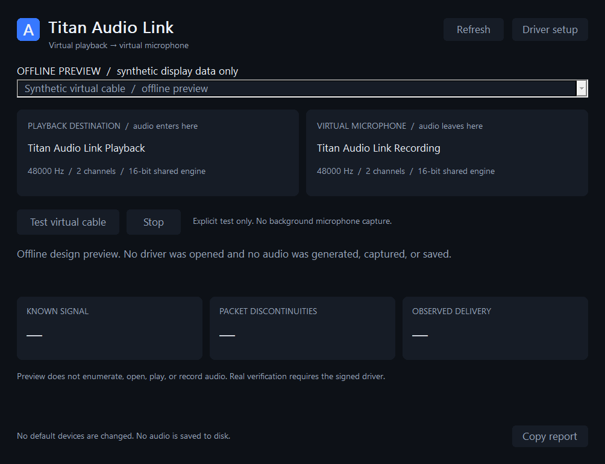

# Titan Audio Link - Windows Kernel Virtual Audio I/O Driver & C++ SDK

**Connect a virtual playback output to a virtual microphone input. Build repeatable audio tests and integrate virtual audio into Windows software.**

Titan Audio Link provides paired Windows audio endpoints, a native desktop application, a console tool and a small C++ SDK. Send audio to the pair's playback endpoint in one application and select its recording endpoint in another. Each pair has its own kernel transport.

> **Engineering preview.** Microsoft signing and the supported-Windows validation matrix are not complete. Check [validation status](docs/VALIDATION.md) before deployment. An unsigned package is not a usable public driver release. No WHQL certification, universal compatibility or zero-latency claim is made.



## What you can do

- Route an application's output into another application's microphone/recording input through explicitly selected endpoints.
- Generate repeatable audio fixtures for conferencing, recording and communication software tests.
- Inspect endpoint identity, state, format and advertised Windows audio periods.
- Verify a known signal through a paired virtual playback/recording path and copy its diagnostic report.
- Embed the two-file C++ SDK to enumerate endpoints and stream raw PCM through your own worker thread.

The initial native format is **48 kHz, stereo, signed 16-bit PCM**. The SDK presents interleaved floating-point stereo samples and handles its supported Windows shared-engine format conversion. It targets **shared-mode WASAPI**; exclusive capture is unsupported. This preview is not a general mixing desk, network audio system, physical microphone recorder or ASIO driver.

## Install and use

1. Download the complete Windows x64 ZIP from [Releases](https://github.com/titanfyre/Titan-Audio-Link/releases). Preview-only ZIPs explicitly state that an installable driver is absent.
2. When a validated Microsoft-signed package is available, run `Dependencies\TitanAudioLinkSetup.exe` as administrator and choose **Install / reinstall**. Restart Windows only if setup requests it.
3. Open `TitanAudioLink.exe`. Refresh the endpoint list and select the playback/recording pair.
4. In the source application's output settings, select the **Titan Audio Link playback endpoint**. In the receiving application's input settings, select the corresponding Titan Audio Link recording endpoint. Windows can prefix their names with localized labels such as **Line** and **Line In**, and numbers distinguish additional adapters. The application pairs them by their adapter identity, not just their display names.
5. Use **Test virtual cable** to play quiet, independent left/right fixtures into the virtual output and check their arrival at the paired virtual input. Every frame of both sequences must match at the same sample offset, within explicit PCM16 conversion-noise bounds. The test does not open a physical microphone or speaker and does not record audio to disk.

Endpoints are deliberately excluded from Windows default-device selection. Select them explicitly in each application. This also means they cannot be selected as system or communications defaults in this edition. Your physical speakers and microphone remain separate devices.

The application and normal WASAPI streaming do not require administrator rights. Installation, adding pairs and removing them require elevation. Windows microphone privacy permissions can still affect a virtual recording endpoint: allow desktop microphone access in Windows settings if your intended application is denied access.

The setup console supports `/install`, `/uninstall`, `/add-pair` and `/remove-pair <instance-id>`. It manages only this product's root devices and matching driver packages. Up to four pairs can be managed; a pending restart is reported rather than forced. Uninstall removes the owned pairs. The application does not silently create, delete or reconfigure audio devices.

## Run without a driver

```powershell
.\TitanAudioLink.exe --preview
.\AudioLinkCLI.exe --preview
.\AudioLinkCLI.exe --list
```

Preview mode uses clearly labelled synthetic data. A normal inventory is read-only. A live test requires a real, enabled Titan Audio Link pair and reports errors rather than falling back to sample data.

## Minimal C++ use

Add `SDK/AudioLink.h` and `SDK/AudioLink.cpp` to a Windows x64 C++17 project. Link `ole32`, `uuid`, `propsys`, `cfgmgr32` and `avrt`. No WDK or kernel source is needed to build the application.

```cpp
#include "AudioLink.h"
#include <iostream>

int main() {
    auto inventory = AudioLink::List();
    if (inventory.error) {
        std::wcerr << AudioLink::Describe(inventory.error);
        return 1;
    }
    for (const auto& endpoint : inventory.endpoints)
        std::wcout << endpoint.name << L"\n" << endpoint.id << L"\n";
}
```

`List()` returns verified Titan endpoints; `List(true)` also returns read-only information about other Windows audio endpoints. Each endpoint includes its stable Windows endpoint ID, direction, state, adapter instance, mix format and advertised periods. IDs identify installed endpoint instances; they are not permanent machine identities.

`Stream(endpointId, callback, stopEvent, durationMs)` detects the endpoint's direction. A playback callback fills the supplied stereo sample block; a recording callback reads it. Return `false` to stop. Keep the callback short, do not resize or retain its sample block, and run the function on a worker thread. COM, WASAPI and cleanup stay on that same thread. See [the streaming example](Examples/GenerateTone.cpp).

`Test(renderId, captureId, durationMs, stopEvent)` verifies an explicitly selected pair and returns metrics plus a detailed English error when necessary. It rejects physical endpoints and endpoints from different adapters. `Describe(error)` includes the failing stage and HRESULT. See [SDK details](docs/SDK.md).

## Understand the results

Audio periods are Windows API values, not measured end-to-end delay. The transport reserves **5 ms plus the current native playback and capture packet durations** to absorb independently scheduled batches: two 10 ms packets mean a 25 ms reserve. WaveRT/Windows audio-engine buffering and normal scheduling add further delay. Native packets are limited to 1-40 ms. The bounded kernel ring can hold 160 ms; its capacity is not a fixed 160 ms delay.

Signal correlation and sample offset describe the test fixture's alignment through this virtual path. The reported delivery interval uses WASAPI capture timestamps and render submission timestamps. It is not physical microphone latency, acoustic latency, application processing time or a round-trip through a game, meeting service or network. WASAPI discontinuity flags are not a complete count of every possible internal underrun. See [measurement boundaries](docs/VALIDATION.md).

## Build

Install Visual Studio 2022 with C++ desktop tools, CMake and a Windows SDK:

```powershell
.\Build.ps1
.\Build.ps1 -AddressSanitizer
```

Application, SDK, examples and offline tests are public. The adapted kernel driver source stays private. Driver development and signing are separate from building this application. Current targets are Windows 10 2004+ and Windows 11 x64; actual tested builds are listed in the validation document.

## OEM integration and support

For virtual audio in your software, a branded package, reproducible audio QA fixtures or deployment/support work, add **`titancsa` on Discord**. Mention the intended workflow, supported Windows builds and deployment volume. We agree scope, acceptance tests and redistribution terms before a commercial engagement. No purchase or automatic activation is performed by this application.

See [commercial integration](docs/COMMERCIAL.md) for the pilot and delivery process.

The application and its original user-mode SDK are MIT licensed. The private driver has separate terms and incorporates Microsoft sample components under MS-PL; see [third-party notices](THIRD-PARTY-NOTICES.md). These engineering previews do not implement an enforced timer or online licensing. Existing Interceptor/Vdevice activation keys do not activate this driver.

Use the software only for authorized audio routing and testing. No illegal or unauthorized use is endorsed. Software is provided AS IS under its applicable license; users remain responsible for their actions, subject to applicable law.
